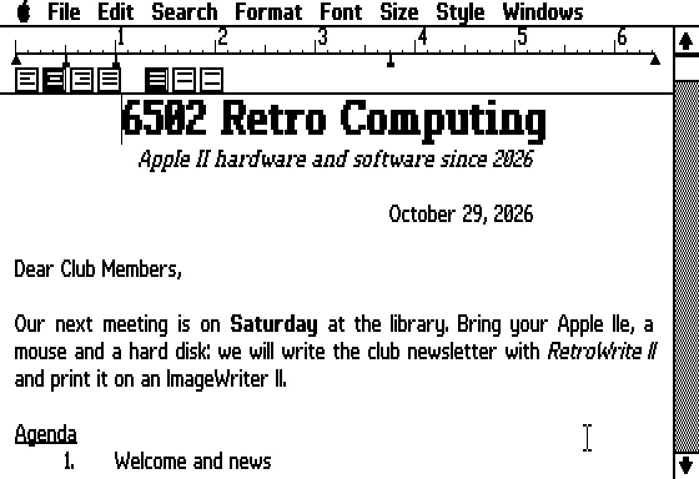
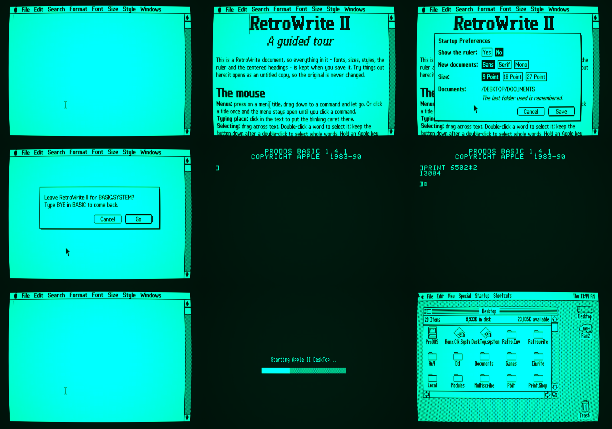
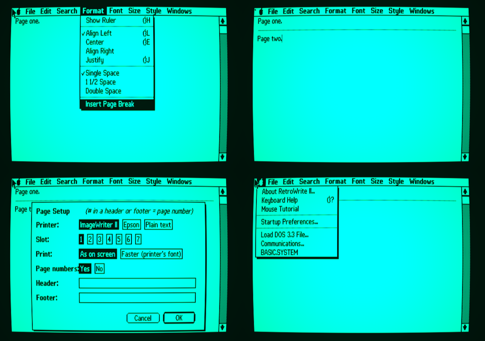
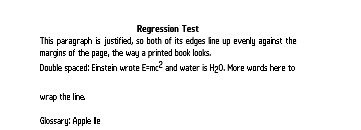

# RetroWrite II

A mouse-driven word processor for the **enhanced Apple IIe** (128K) under
ProDOS 8, in the spirit of MacWrite, MultiScribe and MouseWrite. It draws in
double hi-res (560×192) with its own fonts, and is designed for a hard disk.

**Version 2.1** · [User's Manual (PDF)](docs/RetroWrite_II_Manual.pdf)

## Features

- Pull-down menus driven by the mouse or by Open-Apple keys
- Three original fonts (Sans, Serif, Mono) in 9, 18 and 27 point
- Bold, italic, underline, superscript and subscript
- A ruler for margins, tab stops, alignment (left, center, right, justify) and line spacing
- Printing to an ImageWriter II, an Epson-compatible or a plain-text printer, in graphics ("as on screen") or the printer's own font
- Headers, footers, page numbers and page breaks; Print Several
- Find, Find Next and Replace
- A spelling checker with a 128,000-word dictionary, suggestions and a user dictionary
- A glossary (Control-G and a letter inserts stored text)
- Up to four documents open at once
- Desk accessories: Startup Preferences, Load DOS 3.3 File, Communications (Super Serial Card terminal), and BASIC.SYSTEM (type `BYE` to come back)
- A Mouse Tutorial document
- Opens and saves plain ProDOS text files as well as its own documents

| Menu | Items |
|---|---|
| Apple | About · Keyboard Help · Mouse Tutorial · Startup Preferences · Load DOS 3.3 File · Communications · BASIC.SYSTEM |
| File | New · Open · Close · Save · Save As · Save As Text · Page Setup · Print · Print Several · Quit |
| Edit | Cut · Copy · Paste · Clear · Select All · Glossary · Edit Glossary |
| Search | Find · Find Next · Replace · Check Spelling · Edit User Dictionary |
| Format | Show Ruler · Align Left / Center / Align Right / Justify · Single, 1½ or Double Space · Insert Page Break |
| Font | Sans · Serif · Mono |
| Size | 9 · 18 · 27 point |
| Style | Plain Text · Bold · Italic · Underline · Superscript · Subscript |
| Windows | Up to four open documents |

## Requirements

- An enhanced Apple IIe (65C02) with 128K (an extended 80-column card)
- A mouse
- A hard disk (or large disk image) with ProDOS 8; RetroWrite II takes about 600K including its dictionary
- Optional: an ImageWriter II or Epson-compatible printer; a Super Serial Card for Communications

## Installing

The ready-to-use files are in [`prebuilt/`](prebuilt). Copy them into one
folder (for example `/HD/RETROWRITE`) on your ProDOS disk with these types:

| File | ProDOS type | Aux type |
|---|---|---|
| RW2.SYSTEM | SYS ($FF) | $2000 |
| RW2.MAIN | BIN ($06) | $4000 |
| RW2.LC | BIN | $D400 |
| RW2.FONTS, RW2.OVL1 – RW2.OVL7, RW2.SPLASH, SPELL.DICT | BIN | $0000 |
| TUTORIAL, LETTER | $50 (GWP) | $5257 |
| GLOSSARY | TXT ($04) | $0000 |

Then run `RW2.SYSTEM`. Copy `BASIC.SYSTEM` into the same folder if you want the
Apple → BASIC.SYSTEM accessory.

### With the installer (on a PC or Mac)

`install/install_rw2.py` writes all the files into a ProDOS disk image, sets the
file types, copies BASIC.SYSTEM from elsewhere on the disk if there is one,
and adds RetroWrite II to Apple II DeskTop's Shortcuts menu. It needs Python 3,
Java and [AppleCommander](https://applecommander.github.io/)'s command-line
`ac.jar`:

    python3 install/install_rw2.py MYDISK.po --ac path/to/ac.jar --files prebuilt

Back up your disk image first.

## Building from source

You need [cc65](https://cc65.github.io) (2.19 or later) and Python 3:

    ./build.sh                     # or: CC65_BIN=/path/to/cc65/bin ./build.sh

This writes everything into `build/`; the result is byte-for-byte the same as `prebuilt/`.

| Folder | Contents |
|---|---|
| `src/` | The program: C and 65C02 assembly for cc65. `main.c` and `core.c` stay in memory; `ovl_*.c` are overlays loaded from disk when needed (files, spelling, editing, menus, printing, accessories, dialogs). `gfx.s` draws text and graphics in double hi-res. |
| `loader/` | `RW2.SYSTEM`: checks the machine, shows the splash picture and loads the program |
| `art/` | The fonts (`font_*.py`, compiled by `mkfonts.py`), splash picture, tutorial and sample-document generators |
| `install/` | The disk-image installer |
| `man/` | The manual's source (`mkmanual.py`, needs `reportlab`) and the screen pictures used in it |
| `docs/` | The User's Manual as a PDF |

To rebuild the manual: `cd man && python3 mkmanual.py ../docs/RetroWrite_II_Manual.pdf`.

## Document format

RetroWrite II documents are ProDOS type $50 with aux type $5257 ("RW"). The
manual's Appendix E describes the format: a 105-byte header (`RW2D`, version,
margins, tab stops, header and footer) followed by ASCII text with format bytes
($80 + font, size and style bits) and paragraph marks.

## Notes

- Tested in the [apple2js](https://github.com/whscullin/apple2js) emulator, including printing (captured from the printer port). It has not yet been run on real hardware — reports are welcome.
- On a stock 1 MHz IIe typing takes about a quarter of a second per character; type-ahead is never lost, and an accelerator helps a lot.
- The spelling dictionary was built from the English word list of [pyspellchecker](https://github.com/barrust/pyspellchecker) (MIT), plus Apple II words.

## Licence

MIT — see [LICENSE](LICENSE). RetroWrite II is an independent program by
6502 Retro Computing. It is not a product of Apple or of the publishers of
MacWrite, MultiScribe or MouseWrite, and contains no code from them.

## Screenshots

